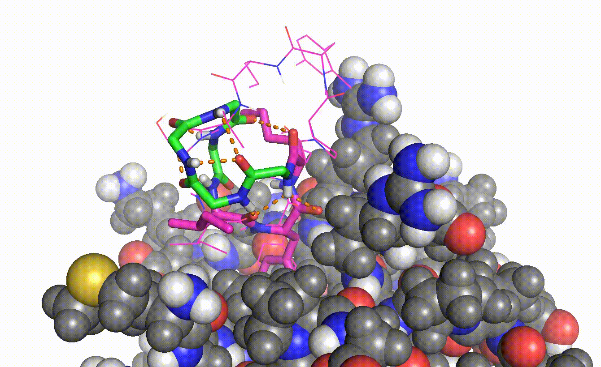

# Continuous Structural Latent Space for Macrocyclic Peptide Backbone Design

## Authors

Vikram K. Mulligan (vmulligan@flatironinstitute.org)

Andrew Powers (apowers@flatironinstitute.org)



## Description
Given an anchor, failed design, or motif allow the heterochiral design/redesign of backbone/scaffold for macrocycles.
Structure minimzation and Markov Chain Monte Carlo (MCMC) structure search.

## Inference

You can perform inference for any of the methods below:

- Inpaint (Motif Scaffolding)
    `--inpaint`
- MCMC Metropolis-Hastings
    `--mcmc`
- Energy Minimization
    `--energy-search`

The general approach for running inference is as such:
```
# base run
python ./python/energy_gradient.py --weights-load <path/to/weights> --dataset <binary/file/of/input/dofs> --<method> --<extra method specific params>
```

All of the method specifc params are shown here:

```
usage: energy_gradient.py [-h] [--steps STEPS] [--prefix-outfile PREFIX_OUTFILE] [--silentfile] [--score-outputs] [--apply-minmover-outputs]
                          [--desired-motif-start-position DESIRED_MOTIF_START_POSITION] [--output-path OUTPUT_PATH] [--extract-minimize-input] [--weights-load WEIGHTS_LOAD]
                          [--out-size OUT_SIZE] [--lr LR] [--cutoff-true] [--cutoff CUTOFF] [--latent-dim LATENT_DIM] [--partial-optimization]
                          [--freeze-residues FREEZE_RESIDUES [FREEZE_RESIDUES ...]] [--l-homochiral] [--freeze-torsion] [--freeze-bond-angle] [--freeze-bond-length]
                          [--lambda-partial LAMBDA_PARTIAL] [--energy-search] [--mcmc] [--batch-size BATCH_SIZE] [--sigma SIGMA] [--temperature TEMPERATURE]
                          [--initial-steps INITIAL_STEPS] [--ramp-down RAMP_DOWN] [--retain-structure] [--inpaint] [--inpaint-dist INPAINT_DIST] [--scaffold-num SCAFFOLD_NUM]
                          [--sgd-optim] [--gpu] [--termbond-test] [--minimize-steps MINIMIZE_STEPS] [--mcmc-steps MCMC_STEPS] [--mcmc-paths MCMC_PATHS] [--pdb-input PDB_INPUT]
                          [--random-sample] [--skip-individual] [--interface-cutoff INTERFACE_CUTOFF] [--treat-input-binder-as-cyclic] [--peptide-chain PEPTIDE_CHAIN]
                          [--interface-distance-cutoff INTERFACE_DISTANCE_CUTOFF] [--fullpocket-minimize] [--ramp-interface-constraint] [--complex-output]
                          [--exclude-atom-from-dof EXCLUDE_ATOM_FROM_DOF [EXCLUDE_ATOM_FROM_DOF ...]] [--energy-weight ENERGY_WEIGHT] [--latent-space-exploration]
                          [--latent-space-training-dataset LATENT_SPACE_TRAINING_DATASET]

options:
  -h, --help            show this help message and exit
  --steps STEPS         Search Steps Max (default: 1000)
  --prefix-outfile PREFIX_OUTFILE
                        PDB/SilentFile prefix (default: test)
  --silentfile          Save Model outputs in a SilentFile format if not specified then individual PDBs are produced. (default: False)
  --score-outputs       Score each Model output and save in SilentFile (not implemented yet to save score to separate file when Silent not set). (default: False)
  --apply-minmover-outputs
                        Apply the MinMover with ref2015 score to our threaded poses. (default: False)
  --desired-motif-start-position DESIRED_MOTIF_START_POSITION
                        Specifies where the Moitf will start on CyclicCAE outputs. We suggest the middle of the peptide, so for an 8mer output, resi 4 for a singular AA. (default: 4)
  --output-path OUTPUT_PATH
                        Determines location PDBs/SilentFile are saved. (default: ./)
  --extract-minimize-input
                        Minimize a given input only (default: False)
  --weights-load WEIGHTS_LOAD
                        Specify Model Weights To Use. Only needs to be specified for custom weights or custom default weight locations. (default: .)
  --out-size OUT_SIZE   Specify the output size (default: None)
  --lr LR               Optimizer Learning Rate (default: 0.001)
  --cutoff-true         Apply a distance cutoff (default: False)
  --cutoff CUTOFF       Specify Euclidean Distance Cutoff in Latent Space to Search (default: 0.005)
  --latent-dim LATENT_DIM
                        Latent Size of the model (default: 6)
  --partial-optimization
                        Apply partial optimization to a structure (default: False)
  --freeze-residues FREEZE_RESIDUES [FREEZE_RESIDUES ...]
                        Used wth partial-optimization. If no sub freeze flags specified all are frozen Specify residues in a whitespace manner to freeze (e.g. 1 2 3) (default: None)
  --l-homochiral        Generate only L-homochiral outputs (default: False)
  --freeze-torsion      Use with partial-optimization (default: False)
  --freeze-bond-angle   Use with partial-optimization (default: False)
  --freeze-bond-length  Use with partial-optimization (default: False)
  --lambda-partial LAMBDA_PARTIAL
                        Reweight Partial Freezing (default: 1.0)
  --energy-search       Gradient Search on dE/d(latent space) (default: False)
  --mcmc                Markov Chain Monte Carlo Metropolis Hastings Search, you do not need to set this with --inpaint (default: False)
  --batch-size BATCH_SIZE
                        Used with mcmc. Set number of trajectories (default: 10)
  --sigma SIGMA         Used with mcmc. Set sigma of normal movement to add to latent point (default: 0.01)
  --temperature TEMPERATURE
                        Used with mcmc. Set Temperature (default: 1)
  --initial-steps INITIAL_STEPS
                        Used with mcmc. Set initial steps to accept no matter what (default: 0)
  --ramp-down RAMP_DOWN
                        Used with mcmc. Steps to go from temperature to 1 (default: 0)
  --retain-structure    Used with mcmc. Walks path closer to input structure (default: False)
  --inpaint             Provide Frozen Residues and generate scaffolds (default: False)
  --inpaint-dist INPAINT_DIST
                        Cutoff distance (p1norm) to consider a scaffold a success (default: 300.0)
  --scaffold-num SCAFFOLD_NUM
                        Number of Inpainted Scaffolds to generate (default: 30)
  --sgd-optim           Use SGD optimizer with momentum 0.9. AdamW is used by default (default: False)
  --gpu                 Use a GPU for inference (default: False)
  --termbond-test       Run Terminal Bond Constraint Generation (default: False)
  --minimize-steps MINIMIZE_STEPS
                        Number of energy minimization steps to take when using --minimize-mcmc (default: 1000)
  --mcmc-steps MCMC_STEPS
                        Number of MCMC steps (t), this needs to be passed and > 0 to work if you want MCMC search after finding scaffolds with --inpaint. (default: 0)
  --mcmc-paths MCMC_PATHS
                        Number of MCMC Paths that use B_i as a starting point. This generates (B) -> (B, mcmc_paths) number paths. Only the lowest energy path for a B_i is selected at
                        the end of MCMC. (default: 10)
  --pdb-input PDB_INPUT
                        PDB input that has our target proteins and our motif reference. (default: None)
  --random-sample       Sample latent space randomly, without a reference. (default: False)
  --skip-individual     For skipping individual construct trajectory outputting during inpainting (default: False)
  --interface-cutoff INTERFACE_CUTOFF
                        Metric for accepting a not clashing peptide [10.0 for compact pockets, 20.0 for others] (default: 20.0)
  --treat-input-binder-as-cyclic
                        Apply Rosetta cyclic constraints to our Motif Chain (--peptide-chain) Only specify this if the Motif Chain is a N-C cyclic peptide. (default: False)
  --peptide-chain PEPTIDE_CHAIN
                        Chain String that contains our motif of interest. The model expects input PDBS to have two chains currently (target & binder/peptide.) (default: B)
  --interface-distance-cutoff INTERFACE_DISTANCE_CUTOFF
                        Atoms within this distance cutoff of the target will be considered when gradient-marching peptide (default: 15.0)
  --fullpocket-minimize
                        Specify if pocket context takes into account all non-hydrgoen bb and side-chain atoms or only bb-heavy + Cb atoms (which is default if you don't specify this
                        flag) (default: False)
  --ramp-interface-constraint
                        This sets the first 0.50 of the energy minimize steps to bb-heavy + Cb pocket context. Then for the last 0.50 switches to full pocket context (all heavy atoms).
                        If not set then uses passed pocket specification throughout (default: False)
  --complex-output      Output scaffolds in complex with target structure (default: False)
  --exclude-atom-from-dof EXCLUDE_ATOM_FROM_DOF [EXCLUDE_ATOM_FROM_DOF ...]
                        Exclude an atom's DoFs from consideration by passing in the residue index number and atom number with (N,phi(0), Ca(1), C,psi(2), O(3), NH(4), Omega: 6) as the
                        numbering. (e.g. --exclude-atom-from-dof 1:0 1:3) (default: [])
  --energy-weight ENERGY_WEIGHT
                        Energy weight term to be used during gradient descent energy minimization. (default: 1.0)
  --latent-space-exploration
                        This is only used to extract latent space information, so we can plot and extract metadata (default: False)
  --latent-space-training-dataset LATENT_SPACE_TRAINING_DATASET
                        If using --latent-space-exploration, then pass this as well. This should be an already extracted .pt dataset used in training (default: None)
```


## Training Model

If you would like to retrain the model currently you can run the script `model.py`:

```
# Train model with default parameters
python ./python/model.py --dataset-tensor <path/to/dataset>
```

The curent model was trained with first training on `./python/binary_import/dof_vectors_clusters_firstten2024-04-11torch_tensor.pt`
then `./python/binary_import/dof_vectors2024-04-10torch_tensor.pt`

You can change the model's default parameters with the flags below:

```
usage: model.py [-h] [--dataset-tensor DATASET_TENSOR] [--epochs EPOCHS] [--num-encoder-layers NUM_ENCODER_LAYERS] [--num-decoder-layers NUM_DECODER_LAYERS] [--latent-space LATENT_SPACE]
                [--batch-size BATCH_SIZE] [--learning-rate LEARNING_RATE] [--output_weights_every_n OUTPUT_WEIGHTS_EVERY_N] [--load-weights LOAD_WEIGHTS]
                [--path-to-output-dir PATH_TO_OUTPUT_DIR] [--plotly-latent-animate PLOTLY_LATENT_ANIMATE] [--angle-decomposition ANGLE_DECOMPOSITION] [--override-lr] [--dropout DROPOUT]
                [--noise-std NOISE_STD] [--cyclic] [--linear-pe] [--overfit] [--overfit-n OVERFIT_N] [--convolution] [--rotation-permutation] [--noise-iterations NOISE_ITERATIONS]
                [--shuffle-samples] [--subset-size SUBSET_SIZE] [--shards]

options:
  -h, --help            show this help message and exit
  --dataset-tensor DATASET_TENSOR
                        Path to .pt dataset file. (defualt: ./binary_import/dof_vectors2024-02-20torch_tensor.pt)
  --epochs EPOCHS       Number of epochs to train (default: 1000)
  --num-encoder-layers NUM_ENCODER_LAYERS
                        Number of encoder layers in the model (default: 3)
  --num-decoder-layers NUM_DECODER_LAYERS
                        Number of decoder layers in the model (default: 3)
  --latent-space LATENT_SPACE
                        Latent Space R dimension (default: 3)
  --batch-size BATCH_SIZE
                        Specify model batch size (default: 32)
  --learning-rate LEARNING_RATE
                        Specify the LR (default: 1e-3)
  --output_weights_every_n OUTPUT_WEIGHTS_EVERY_N
                        Output saved model weights every N number of epochs (default: 1000)
  --load-weights LOAD_WEIGHTS
                        Load in specific weights from known stopping position. (default: None)
  --path-to-output-dir PATH_TO_OUTPUT_DIR
                        Specify model output specific directory (default: /mnt/ceph/users/apowers/outputs_old/)
  --plotly-latent-animate PLOTLY_LATENT_ANIMATE
                        Generate plotly latent 3D matrix. Specify the N epochs to take snapshot (default: 0)
  --angle-decomposition ANGLE_DECOMPOSITION
                        Decompose the angle into sin/cos N times (default: 1)
  --override-lr         Pass flag if you don't want to load weights LR in.
  --dropout DROPOUT     Apply Dropout (default: 0.0)
  --noise-std NOISE_STD
                        Training noise added to degrees (default: 5.0)
  --cyclic              Use Cyclic Positional Encodings
  --linear-pe           Use Linear Positional Encodings
  --overfit             Select only a couple samples to overfit
  --overfit-n OVERFIT_N
                        Select sample amount (default: 0)
  --convolution         Include Convolution after PE embedding
  --rotation-permutation
                        Include Rotation Permutations of Data only Torsion currently
  --noise-iterations NOISE_ITERATIONS
                        Number of rounds of noise during a batch (default: 0)
  --shuffle-samples     We don't use the full dataset each epoch, but a subset. Shuffles each epoch
  --subset-size SUBSET_SIZE
                        Works in conjunction with shuffle-samples
  --shards              If the dataset is large indicate this, and we will search for the 'shards' files in the same location.
```

## Rosetta Patch

Although CyclicCAE is a standalone neural network, various Rosetta modifications were needed to facilitate the generation of training data, or the visualization of CyclicCAE-generated structures.  These are made available as a patch for Rosetta 3.15.  This has been tested with Rosetta Git SHA1 `bbb6a2d27c70be05b2fb2409f3920b5894967d60`.

To apply the patch, copy it to the `Rosetta/main` directory.  Then navigate to this directory and run this command:

```
patch -p 1 -i cycliccae_patch_for_rosetta.txt
```

The effect of the patch is to add the `extract_dof_vectors` application used for generating training data, the `dof_vectors_to_poses` application used to visualize CyclicCAE output, and the `align_ml_backbones_to_original_target` application used to place CyclicCAE-generated backbones in a binding pocket on a target during binder design.  The support class `protocols::conformational_autoencoder::DoFSummary` is also added by the patch.

The patch also makes modifications to `Rosetta/main/source/src/basic/options/options_rosetta.py` to add the `conformational_autoencoder` options group, which contains commandline options for the `extract_dof_vectors` and `dof_vectors_to_poses` applications.  It also makes small adjustments to the `core::import_pose::pose_stream::PDBPoseInputStream` class, defined in `Rosetta/main/source/src/core/import_pose/pose_stream/PDBPoseInputStream.cc`, and to the `core::import_pose::pose_stream::SilentFilePoseInputStream` class, defined in `Rosetta/main/source/src/core/import_pose/pose_stream/SilentFilePoseInputStream.cc`, to permit more efficient processing of many structures.

This patch is released under a free and open-source BSD 3-clause licence.

